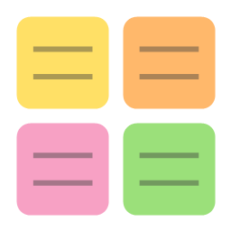

# TodoStickers

Sticky notes for your Windows desktop. See all your notes at once on one board.



## How to install (step by step)

1. Open the [**Releases**](../../releases/latest) page of this repository.
2. Under **Assets**, click **`TodoStickers-Setup-x.y.z.exe`** to download it.
3. Double-click the downloaded file.
4. If Windows shows *"Windows protected your PC"*, click **More info → Run anyway**.
   (This appears because the installer isn't code-signed; it's safe.)
5. Wait a few seconds. TodoStickers installs itself and opens.
6. From now on, start it from the **TodoStickers** icon on your desktop or in the Start menu.

## How to use

- **+ Add note** (top right) adds a new sticky note.
- Click inside a note and start typing; everything saves automatically.
- Select text, then use **Font**, **Size**, **B**, **I**, **U** or **• List** in the top bar.
- Drag a note by its top strip to move it; drag its edge or corner to resize it.
- Click the **⛶** button on a note to open it large; click outside it (or press Esc) to shrink it back.
- **⚙️ Settings** sets how many notes fit across and down the screen.
  **Default** resets layout and sizes, **Arrange notes** lines the notes back up.

## Uninstall

**Windows Settings → Apps → Installed apps → TodoStickers → Uninstall**.

## Features

- A board of sticky notes (3 × 4 by default) that scales with the window
- Add / delete notes, rename them, pick a color per note
- Bold, italic, underline and bullet lists
- Font and size for the selected text, plus A− / A+ for a whole note
- Drag notes anywhere by their top strip; resize from the edge or corner
- Scrolls when the board is full
- Saves automatically on every change, no Ctrl+S needed

Notes are stored per user in `%APPDATA%\TodoStickers\notes.json`.

## Run from source

Requires [Node.js](https://nodejs.org) 18+.

```bash
npm install
npm start
```

## Build the installer

```bash
npm run dist
```

The installer is written to `dist/TodoStickers-Setup-<version>.exe`. Upload it to a GitHub Release.
